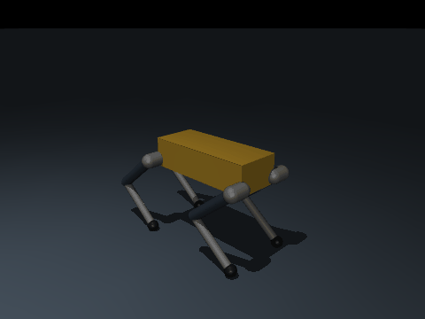

# Submission — HRC Software Onboarding Fall 2026

**Name: Ethan Corazza**
**Discord handle: ReversedMoon**
**Repository: https://github.com/ReversedMoon/onboarding-fall26**
**Date: 10/18/2026**

---

## Stage checklist

- [1] **Stage 0** — Setup. `scripts/check_setup.py` exits 0.
- [1] **Stage 1** — MuJoCo + PD controller. Tests green.
- [1] **Stage 2** — JAX exercises. Tests green.
- [1] **Stage 3** — MJX environment. Tests green.
- [1] **Stage 4** — Brax PPO. Trained a policy, exported it, `NumpyPolicy` matches.
- [1] **Stage 5** — ROS 2 sim2sim. Smoke test green, teleop GIF recorded.

## `scripts/progress.py` output

<details>
<summary>...................................                                                                              [100%]
================================================== warnings summary ===================================================
.venv\Lib\site-packages\jaxopt\__init__.py:59
  C:\projects\onboarding-fall26\.venv\Lib\site-packages\jaxopt\__init__.py:59: DeprecationWarning: JAXopt is no longer maintained. See https://docs.jax.dev/en/latest/ for alternatives.
    warnings.warn(

-- Docs: https://docs.pytest.org/en/stable/how-to/capture-warnings.html

Pup onboarding progress
  ✓ PASSED        Stage 1  MuJoCo + PD controller    12 passed, 0 failed, 0 not started, 0 skipped
  ✓ PASSED        Stage 2  JAX for robotics          9 passed, 0 failed, 0 not started, 0 skipped
  ✓ PASSED        Stage 3  MJX environment           11 passed, 0 failed, 0 not started, 0 skipped
  ✓ PASSED        Stage 4  Brax PPO + export         3 passed, 0 failed, 0 not started, 0 skipped
35 passed, 1 skipped, 3 deselected, 1 warning in 278.50s (0:04:38)

==============================================================================
PUP ONBOARDING PROGRESS
==============================================================================
✓ PASSED         Stage 1  MuJoCo + PD controller    12 passing
✓ PASSED         Stage 2  JAX for robotics          9 passing
✓ PASSED         Stage 3  MJX environment           11 passing
✓ PASSED         Stage 4  Brax PPO + export         3 passing
◻ CONTAINER      Stage 5  ROS 2 sim2sim             run tests/test_05_ros2_smoke.sh inside docker/ros2
==============================================================================
Every TODO(student) block is written. Nice.</summary>

```
$ uv run python scripts/progress.py --slow
PS C:\projects\onboarding-fall26> uv run python scripts/progress.py --slow
$ C:\projects\onboarding-fall26\.venv\Scripts\python.exe -m pytest -q --tb=no -m not gpu and not ros

....................................                                                                             [100%]
================================================== warnings summary ===================================================
.venv\Lib\site-packages\jaxopt\__init__.py:59
  C:\projects\onboarding-fall26\.venv\Lib\site-packages\jaxopt\__init__.py:59: DeprecationWarning: JAXopt is no longer maintained. See https://docs.jax.dev/en/latest/ for alternatives.
    warnings.warn(

tests/test_04_train_smoke.py::test_cpu_smoke
  C:\projects\onboarding-fall26\.venv\Lib\site-packages\brax\training\agents\ppo\train.py:756: DeprecationWarning: jax.device_put_replicated is deprecated; use jax.device_put instead.
    training_state = jax.device_put_replicated(

-- Docs: https://docs.pytest.org/en/stable/how-to/capture-warnings.html

Pup onboarding progress
  ✓ PASSED        Stage 1  MuJoCo + PD controller    12 passed, 0 failed, 0 not started, 0 skipped
  ✓ PASSED        Stage 2  JAX for robotics          9 passed, 0 failed, 0 not started, 0 skipped
  ✓ PASSED        Stage 3  MJX environment           11 passed, 0 failed, 0 not started, 0 skipped
  ✓ PASSED        Stage 4  Brax PPO + export         4 passed, 0 failed, 0 not started, 0 skipped
36 passed, 1 skipped, 2 deselected, 2 warnings in 324.71s (0:05:24)

==============================================================================
PUP ONBOARDING PROGRESS
==============================================================================
✓ PASSED         Stage 1  MuJoCo + PD controller    12 passing
✓ PASSED         Stage 2  JAX for robotics          9 passing
✓ PASSED         Stage 3  MJX environment           11 passing
✓ PASSED         Stage 4  Brax PPO + export         4 passing
◻ CONTAINER      Stage 5  ROS 2 sim2sim             run tests/test_05_ros2_smoke.sh inside docker/ros2
==============================================================================
Every TODO(student) block is written. Nice.
```

</details>

## Stage 4 — training results

**Config used:** (`full` / **t4_fast** / other) &nbsp; **Seed:0** &nbsp;
**Where it ran:** (**Colab T4** / local GPU / …) &nbsp; **Wall-clock: seconds: 725.4568487910001**

Learning curve: 
Rollout GIF: 



```json
(paste results/eval_training.json)
{
  "seed": 0,
  "n_episodes": 5,
  "commands": [
    {
      "command": [
        0.5,
        0.0,
        0.0
      ],
      "mean_abs_error": [
        0.08061610340848566,
        0.047633581805450374,
        0.0859993431993178
      ],
      "mean_abs_vy": 0.0476335808634758,
      "mean_speed": 0.5587805509567261,
      "fall_rate": 0.0,
      "mean_episode_length": 1000.0
    },
    {
      "command": [
        1.0,
        0.0,
        0.0
      ],
      "mean_abs_error": [
        0.09533877936750651,
        0.05379282103813603,
        0.0939185553149553
      ],
      "mean_abs_vy": 0.05379282310605049,
      "mean_speed": 1.0480159521102905,
      "fall_rate": 0.0,
      "mean_episode_length": 1000.0
    },
    {
      "command": [
        0.0,
        0.5,
        0.0
      ],
      "mean_abs_error": [
        0.04604221925494494,
        0.0964701420687139,
        0.08590888955501723
      ],
      "mean_abs_vy": 0.5781087875366211,
      "mean_speed": 0.5813295841217041,
      "fall_rate": 0.0,
      "mean_episode_length": 1000.0
    },
    {
      "command": [
        0.0,
        0.0,
        1.0
      ],
      "mean_abs_error": [
        0.05270784209500416,
        0.05203861202728003,
        0.09478275414705277
      ],
      "mean_abs_vy": 0.052038609981536865,
      "mean_speed": 0.08256454020738602,
      "fall_rate": 0.0,
      "mean_episode_length": 1000.0
    },
    {
      "command": [
        0.0,
        0.0,
        0.0
      ],
      "mean_abs_error": [
        0.039167460071892125,
        0.039911053176853964,
        0.0821323853447917
      ],
      "mean_abs_vy": 0.03991105407476425,
      "mean_speed": 0.06227688118815422,
      "fall_rate": 0.0,
      "mean_episode_length": 1000.0
    }
  ],
  "walking_passes": true
}

```

Did it meet the acceptance criteria (`"walking_passes": true`)? Yes

## Stage 5 — sim2sim results

Teleop GIF: 


```json
(paste results/eval_sim2sim.json)

{
  "duration_s": 20.0,
  "min_trunk_height": 0.2897405735154557,
  "fell": false,
  "commands": [
    {
      "command": [
        0.5,
        0.0,
        0.0
      ],
      "n_samples": 109,
      "mean_velocity": [
        0.3863261637337782,
        0.0074991769418077964,
        0.005861459589530146
      ],
      "mean_abs_error": [
        0.1136738362662218,
        0.0074991769418077964,
        0.005861459589530146
      ],
      "mean_speed": 0.3864934783856926,
      "threshold": 0.25,
      "passed": true
    },
    {
      "command": [
        1.0,
        0.0,
        0.0
      ],
      "n_samples": 150,
      "mean_velocity": [
        0.3938352346901183,
        0.02203103689235938,
        -0.4573545630225923
      ],
      "mean_abs_error": [
        0.6061647653098817,
        0.02203103689235938,
        0.4573545630225923
      ],
      "mean_speed": 0.3965516122071464
    },
    {
      "command": [
        0.0,
        0.0,
        1.0
      ],
      "n_samples": 150,
      "mean_velocity": [
        -0.08985676459861948,
        0.07243860665353918,
        0.9947465634510856
      ],
      "mean_abs_error": [
        0.08985676459861948,
        0.07243860665353918,
        0.005253436548914414
      ],
      "mean_speed": 0.11710841508585325
    },
    {
      "command": [
        0.0,
        0.0,
        0.0
      ],
      "n_samples": 150,
      "mean_velocity": [
        -0.3735598595988208,
        -0.013700078725191552,
        0.0162957574632609
      ],
      "mean_abs_error": [
        0.3735598595988208,
        0.013700078725191552,
        0.0162957574632609
      ],
      "mean_speed": 0.37409025624909054
    }
  ],
  "passed": true
}
```

Measured `/pup/joint_command` rate from `ros2 topic hz`: 50.000

## Escape hatches used

- [ ] I used `checkpoints/pup_joystick_flat_reference.npz` for Stage 5 instead
      of my own policy.
- [ ] Other (describe):
I used the checkpoint policy for a bit but I got mine to work.
*(Using one is fine. Not declaring one is not.)*

## Reflection — Stage 5

**List two ways sim2sim can pass while real hardware still fails, and what you
would add to the sim node to catch each.**

>

## What was hardest?

Getting headless:=false to work. I genuinely could not figure out how to fix the GLFW error. The closest I got was a window popping up then instantly closing and crashing. 
>

## Time spent

| Stage | Hours |
|---|---|
| 0 Setup |.5hr|
| 1 MuJoCo + PD |2hr|
| 2 JAX |2hr|
| 3 MJX env |6hr|
| 4 Brax + export |5hr|
| 5 ROS 2 |4hr|
| **Total** |20ish| These numbers are pretty guessy, I wasn't timing myself. 

---

**Then DM the software lead (Henry Tsay) on Discord or show during a meeting.**
